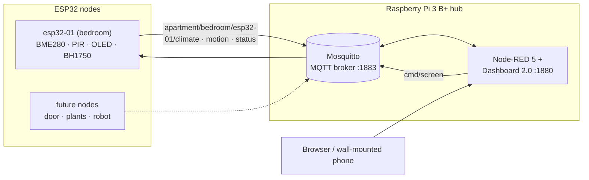

# iot-lab

A home IoT system built from scratch: ESP32 sensor nodes publish over MQTT to a Raspberry Pi hub, which runs Mosquitto and Node-RED and serves a live multi-page dashboard. This repo holds the firmware, hub configuration and build notes as the system grows toward robotics.

> Photos of the hardware and dashboard go in [`docs/img/`](docs/img/).

## Architecture



- **Nodes** do the real-time work: read sensors, drive outputs, react locally. Each publishes JSON to `apartment/<room>/<device>/<metric>`.
- **Hub** routes messages (Mosquitto, authenticated, Last Will for offline detection) and runs the logic and dashboards (Node-RED, pages for Climate, Motion and System).
- **Firmware updates** go over Wi-Fi (OTA), so mounted nodes never need a cable.

## Sketches

Sketches are grouped into three categories:

| Category | Folder | Focus |
|---|---|---|
| 🏠 Home improvement | [`sketches/home/`](sketches/home) | apartment sensing and automation on the MQTT hub |
| 🤖 Robotics | [`sketches/robotics/`](sketches/robotics) | actuators, motion, sensing, a dashboard-driven robot |
| 🚗 Automotive | [`sketches/automotive/`](sketches/automotive) | read-only car data logging and cabin accessories |

| # | Sketch | What it shows | Status |
|---|---|---|---|
| home/01 | [`01-blink`](sketches/home/01-blink) | toolchain bring-up, non-blocking timing | ✅ |
| home/02 | [`02-bme280-bringup`](sketches/home/02-bme280-bringup) | I2C bus scan, chip-ID verification (BME280 vs BMP280), sensor reads | ✅ |
| home/03 | [`03-bedroom-node`](sketches/home/03-bedroom-node) | multi-sensor MQTT node: state machines, Last Will, backoff reconnects, OTA, motion-wake OLED, register-level BH1750 driver | ✅ v0.2 on hardware · v0.3 in test |

Robotics and automotive sketches are planned; see each folder's README.

## Hardware

| Part | Role |
|---|---|
| ELEGOO ESP32 DevKit (ESP-WROOM-32, CP2102) | sensor/actuator nodes |
| Raspberry Pi 3 Model B+ (Raspberry Pi OS Lite 64-bit) | hub: Mosquitto + Node-RED |
| Bosch BME280 (I2C) | temperature, humidity, pressure |
| HC-SR501 PIR | motion |
| SSD1306 0.96" OLED (I2C) | on-node status screen |
| BH1750 (I2C) | ambient light |

## Skills demonstrated
- **Embedded C++ on ESP32:** non-blocking super-loop, `enum class` state machines, compile-time config, secrets kept out of source
- **Buses and bring-up:** I2C scanning, register reads with repeated start, verifying parts by chip ID, sharing one bus across three devices at 400 kHz
- **Networked firmware:** Wi-Fi with exponential backoff, MQTT with Last Will, retained state, command topics, OTA with on-screen progress
- **Linux / hub ops:** headless Pi setup, Mosquitto auth config, systemd overrides, Node-RED flows and dashboards
- **Hardware:** soldering, breadboard layout, power-domain rules (3.3 V logic vs 5 V supply)

## Repo layout
```
sketches/   home/, robotics/, automotive/ — one folder per sketch (folder name == .ino name)
shared/     secrets template + MQTT topic reference
templates/  starting point for new sketches
hub/        Mosquitto config and Node-RED flows for the Pi
pi/         Python scripts for the hub (planned)
cad/        enclosure designs (planned)
docs/       build log and photos
```

## Getting started
1. Install Arduino IDE 2.x and the **esp32 by Espressif** board package (3.3.x).
2. Copy `shared/secrets.example.h` into a sketch folder as `secrets.h` and fill it in.
3. Open the sketch, select **ESP32 Dev Module**, upload.
4. Hub setup: see [`hub/README.md`](hub/README.md).

## Build log
Debugging stories and lessons: [`docs/build-log.md`](docs/build-log.md).

## Roadmap
- [x] Sensor node → MQTT → dashboard
- [x] OTA updates
- [ ] Move node 01 from breadboard to soldered perfboard + enclosure
- [ ] Door/window reed switch node
- [ ] Plant / grow-tent node (soil moisture, DS18B20, VPD in Node-RED)
- [ ] Servo and distance sensing → two-wheel robot controlled over MQTT
